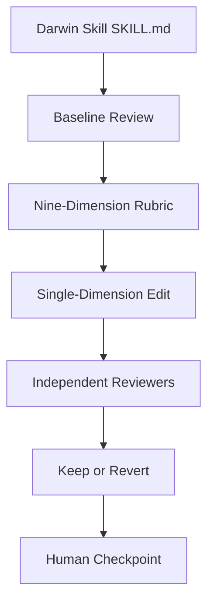

# alchaincyf/darwin-skill

> Skill that improves other SKILL.md files through evaluation cycles, with human safeguards, for skill users.

## The problem
With dozens of skills, you revise them by hand on form only, without measuring whether their real effect improves.

## What it actually does
A SKILL.md describes a loop inspired by autoresearch: baseline evaluation, a 9-dimension rubric (including failure modes, actionable precision, a list of risky actions), edit of a single dimension, re-evaluation by two independent sub-agents, keep if the score rises, otherwise `git revert`. Human pause at each step. Aligned with the SkillLens and SkillOpt papers from Microsoft Research.

## How it is wired


## Trying it
```bash
npx skills add alchaincyf/darwin-skill
```
Then, in the agent: "optimize all skills".

## Cost and gotchas
Free; each cycle launches several sub-agents, hence model calls. Requires a clean git repository. The gains (80.8 to 91.65) are self-reported and on few cases.

## What it is not
Not a fully automatic optimizer: the human validates at each step. README in Chinese and English.

## Alternatives
- SkillOpt (microsoft/SkillOpt): fully autonomous version, cited in the README.

## For you
Worth watching if you maintain many skills; the method (independent evaluators, clean rollback) is reusable, the quantified gain remains to be confirmed.
