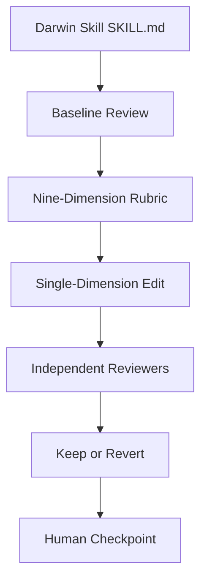

# alchaincyf/darwin-skill

> Skill qui améliore d'autres SKILL.md par cycles d'évaluation, avec garde-fous humains, pour utilisateurs de skills.

## Le problème
Avec des dizaines de skills, on les révise à la main sur la forme, sans mesurer si leur effet réel s'améliore.

## Ce que ça fait vraiment
Un SKILL.md décrit une boucle inspirée d'autoresearch : évaluation de base, grille à 9 dimensions (dont modes d'échec, précision actionnable, liste d'actions à risque), modification d'une seule dimension, ré-évaluation par deux sous-agents indépendants, conservation si le score monte, sinon `git revert`. Pause humaine à chaque étape. Alignée sur les articles SkillLens et SkillOpt de Microsoft Research.

## Comment c'est branché


## Essayer
```bash
npx skills add alchaincyf/darwin-skill
```
Puis, dans l'agent : « optimiser tous les skills ».

## Coût et pièges
Gratuit ; chaque cycle lance plusieurs sous-agents donc des appels modèle. Exige un dépôt git propre. Les gains (80,8 vers 91,65) sont auto-rapportés et sur peu de cas.

## Ce que ce n'est pas
Pas un optimiseur automatique complet : l'humain valide à chaque étape. README en chinois et en anglais.

## Alternatives
- SkillOpt (microsoft/SkillOpt) : version entièrement autonome, citée dans le README.

## Pour toi
À surveiller si tu maintiens beaucoup de skills ; la méthode (évaluateurs indépendants, annulation propre) est réutilisable, le gain chiffré reste à confirmer.

