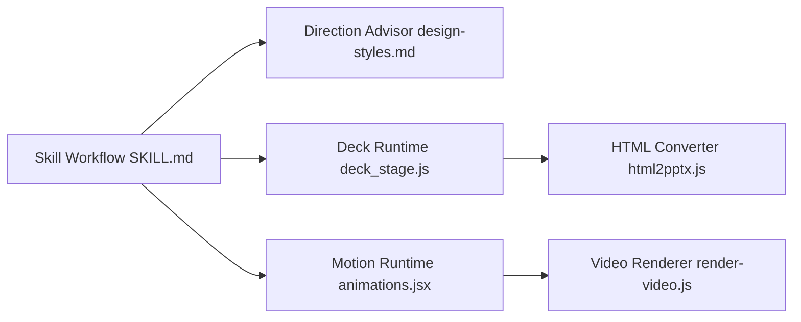

# alchaincyf/huashu-design

> Agent skill that produces HTML prototypes, slideshows, animations and infographics from a single sentence.

## The problem
Getting a design deliverable (clickable mockup, presentation, animation) takes graphic tools and finishing time.

## What it actually does
A skill that delivers HTML prototypes (iPhone), HTML presentations exportable to editable PPTX, MP4/GIF animations and infographics. For a vague request, it proposes six thumbnail candidates and then three real versions, among 84 styles. It applies a brand protocol (colors read from official assets), a "design lint" on facts (contrast, size), and keeps a local appearance log.

## How it is wired


## Trying it
```bash
npx skills add alchaincyf/huashu-design
npm i -g skills@latest
git clone https://github.com/alchaincyf/huashu-design.git ~/.claude/skills/huashu-design
```

## Cost and gotchas
The core flow is local with no key. Cloud options (Doubao TTS voice, AI video review) require your key and a `--yes` confirmation. Older `skills` CLIs (≤ 1.5.15) install only `SKILL.md`: an update is required. README written in Chinese.

## What it is not
Not a Figma tool: HTML output, no layer-by-layer editable PPTX, no Framer-style animations. The author describes it as "80 out of 100"; the license changed to MIT on 2026-05-14.

## Alternatives
Claude Design (web product cited as a point of comparison).

## For you
Ignore: useful for visual presentations, but unrelated to data/AI work; consider it only for communication materials.
