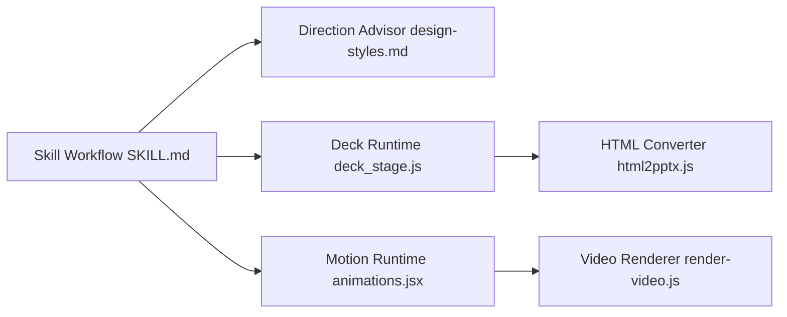

# alchaincyf/huashu-design

> Skill d'agent qui produit prototypes, diaporamas, animations et infographies HTML à partir d'une phrase.

## Le problème
Obtenir un livrable de design (maquette cliquable, présentation, animation) demande des outils graphiques et du temps de finition.

## Ce que ça fait vraiment
Un skill qui livre des prototypes HTML (iPhone), des présentations HTML exportables en PPTX éditable, des animations MP4/GIF et des infographies. Pour une demande vague, il propose six candidats en miniature puis trois versions réelles, parmi 84 styles. Il applique un protocole de marque (couleurs lues dans les ressources officielles), un « design lint » sur les faits (contraste, taille), et tient un journal local d'apparence.

## Comment c'est branché


## Essayer
```bash
npx skills add alchaincyf/huashu-design
npm i -g skills@latest
git clone https://github.com/alchaincyf/huashu-design.git ~/.claude/skills/huashu-design
```

## Coût et pièges
Le cœur du flux est local sans clé. Les options cloud (voix Doubao TTS, relecture vidéo IA) demandent ta clé et une confirmation `--yes`. Les anciens `skills` CLI (≤ 1.5.15) n'installent que `SKILL.md` : mise à jour requise. README rédigé en chinois.

## Ce que ce n'est pas
Pas un outil de Figma : sortie HTML, pas de PPTX éditable calque par calque, pas d'animations de type Framer. L'auteur se décrit comme « 80 points sur 100 » ; la licence est passée à MIT le 2026-05-14.

## Alternatives
Claude Design (produit web cité comme point de comparaison).

## Pour toi
À ignorer : utile pour des présentations visuelles, mais sans lien avec le travail data/IA ; vois-le seulement pour des supports de communication.

