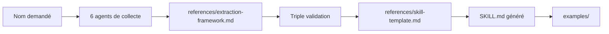

# alchaincyf/nuwa-skill

> Agent skill that distills a public figure's way of thinking into a reusable skill.

## The problem
Getting an expert's viewpoint (Munger, Feynman, Jobs) into an agent requires compiling their writings and interviews by hand, and plain role-play imitates the tone without the reasoning.

## What it actually does
Starting from a name, the skill launches six collection agents (books, interviews, social media, critiques, decisions, timeline), then keeps a mental model only if it shows up in at least two domains, predicts a new position and is not trivial. It writes a SKILL.md with 3 to 7 mental models, heuristics, an expression style and declared limits. The repo ships 13 personalities and one thematic skill, with their research data.

## How it is wired


## Trying it
```bash
npx skills add alchaincyf/nuwa-skill
git clone https://github.com/alchaincyf/nuwa-skill <chemin du dossier skills>
```

## Cost and gotchas
The skill consumes the host agent's model calls (key or subscription at your expense). The fidelity scores (A, 89 to 97) are assigned by the author with a dual-agent test, not verified here. The README is in Chinese, with a reduced English section.

## What it is not
It is not the real thinking of these people: it is a reconstruction from public information, at a given moment, without intuition or changes of mind. The SKILL.md file does not accept external PRs.

## Alternatives
- colleague-skill: cited as a predecessor, distills a colleague rather than a public figure.

## For you
Worth watching: the extraction method is interesting to read when building your own skills, but the personas remain approximations not to be mistaken for expert opinions.
