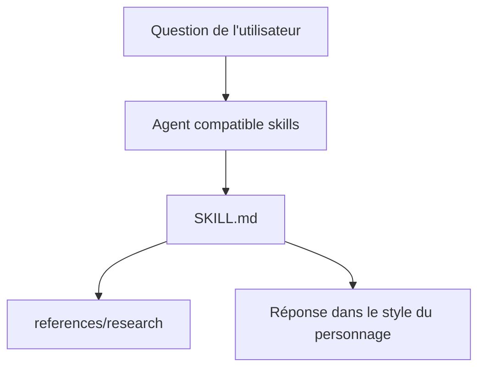

# alchaincyf/zhangxuefeng-skill

> Chinese-language agent skill that imitates the reasoning of an academic advisor to choose a major and studies.

## The problem
Get a structured opinion on choosing a university major, in the style of a well-known figure of academic guidance in China.

## What it actually does
The repository contains a `SKILL.md` file describing five mental models, eight decision heuristics and a style of expression, drawn from books and interviews. Installed in an agent, it answers guidance questions in that mode. Example dialogues are provided.

## How it is wired


## Trying it
```bash
npx skills add alchaincyf/zhangxuefeng-skill
git clone https://github.com/alchaincyf/zhangxuefeng-skill <chemin du dossier skills>
```

## Cost and gotchas
Free, MIT license. Requires an agent that supports skills (Claude Code, Codex, Cursor and others). The README is entirely in Chinese.

## What it is not
It is not the person: it is an imitation drawn from public sources, with blunt career advice that should not be taken as fact.

## Alternatives
- alchaincyf/nuwa-skill: tool by the same author that generates this type of skill.

## For you
Ignore: school guidance advice in Chinese, useless for data, AI or MLOps work; only the skill-building method may be of interest.
