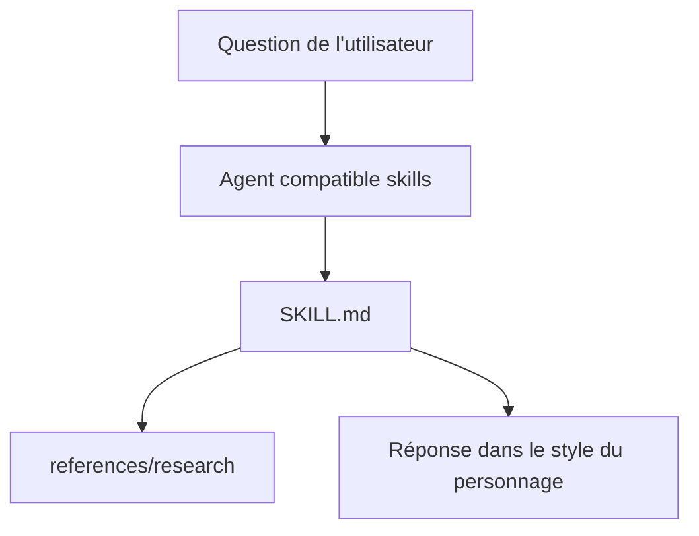

# alchaincyf/zhangxuefeng-skill

> Skill d'agent en chinois qui imite le raisonnement d'un conseiller d'orientation pour choisir filière et études.

## Le problème
Obtenir un avis structuré sur le choix d'une filière universitaire, dans le style d'une figure connue de l'orientation en Chine.

## Ce que ça fait vraiment
Le dépôt contient un fichier `SKILL.md` qui décrit cinq modèles mentaux, huit heuristiques de décision et un style d'expression, tirés de livres et d'entretiens. Installé dans un agent, il répond à des questions d'orientation sur ce mode. Des exemples de dialogues sont fournis.

## Comment c'est branché


## Essayer
```bash
npx skills add alchaincyf/zhangxuefeng-skill
git clone https://github.com/alchaincyf/zhangxuefeng-skill <chemin du dossier skills>
```

## Coût et pièges
Gratuit, licence MIT. Il faut un agent qui accepte les skills (Claude Code, Codex, Cursor et d'autres). Le README est entièrement en chinois.

## Ce que ce n'est pas
Ce n'est pas la personne : c'est une imitation tirée de sources publiques, avec des conseils tranchés sur la carrière à ne pas prendre pour des faits.

## Alternatives
- alchaincyf/nuwa-skill : outil du même auteur qui génère ce type de skill.

## Pour toi
Ignorer : conseil d'orientation scolaire en chinois, sans utilité pour un travail data, IA ou MLOps ; seule la méthode de fabrication de skills peut intéresser.

