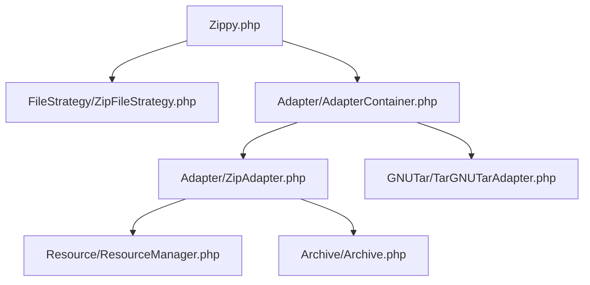

# alchemy-fr/Zippy

> PHP library to read, create and extract zip and tar archives through utilities or extensions.

## The problem
Handling several archive formats in PHP means juggling zip, GNU tar or BSD tar and their options.

## What it actually does
Zippy picks a file strategy based on the extension, then an adapter among those in the container (PHP zip extension, GNU tar, BSD tar). The adapter handles the resources and returns an Archive object to list, extract or add to. Remote http/https resources are downloaded through Symfony HttpClient.

## How it is wired


## Trying it
```bash
composer require alchemy/zippy
```

## Cost and gotchas
Free. Requires PHP 8.1+ and Symfony 6 or 7 components (PHP is not in the prerequisites list). Supported formats depend on the zip or tar binaries installed. A licence is present but not identified by GitHub.

## What it is not
Not a command-line tool: a library to call from PHP code.

## Alternatives
No alternative named in the README.

## For you
Ignore: only useful in PHP, outside the data/AI/MLOps scope.
