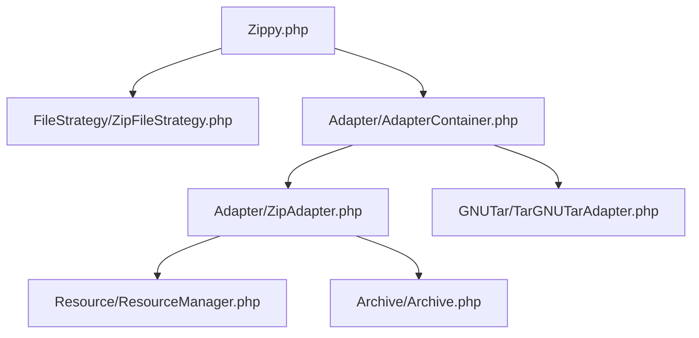

# alchemy-fr/Zippy

> Bibliothèque PHP pour lire, créer et extraire des archives zip et tar via des utilitaires ou extensions.

## Le problème
Manipuler plusieurs formats d'archives en PHP oblige à jongler avec zip, tar GNU ou BSD et leurs options.

## Ce que ça fait vraiment
Zippy choisit une stratégie de fichier selon l'extension, puis un adaptateur parmi ceux du conteneur (extension PHP zip, GNU tar, BSD tar). L'adaptateur manipule les ressources et renvoie un objet Archive à lister, extraire ou compléter. Les ressources http/https distantes se téléchargent via Symfony HttpClient.

## Comment c'est branché


## Essayer
```bash
composer require alchemy/zippy
```

## Coût et pièges
Gratuit. Demande PHP 8.1+ et des composants Symfony 6 ou 7 (PHP n'est pas dans la liste de prérequis). Les formats dépendent des binaires zip ou tar installés. Licence présente mais non identifiée par GitHub.

## Ce que ce n'est pas
Pas un outil en ligne de commande : une bibliothèque à appeler depuis du code PHP.

## Alternatives
Aucune alternative nommée dans le README.

## Pour toi
À ignorer : utile seulement en PHP, hors du périmètre data/IA/MLOps.

