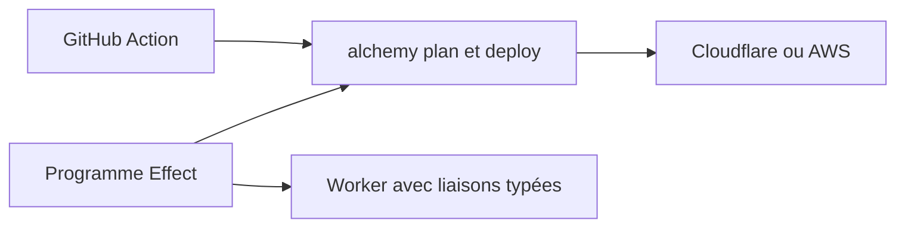

# alchemy-run/alchemy

> A TypeScript library that describes cloud infrastructure and application code in a single Effect program.

## The problem
Infrastructure lives in YAML or a second language, separate from the code that uses it, with IAM wiring done by hand.

## What it actually does
You declare resources and Workers or Lambdas in a typed Effect program. A call like `ReadWriteBucket(Uploads)` adds the binding to the deployment and returns a typed client at runtime. Cloud API errors are typed Effect errors. Targets cited: AWS, Cloudflare, GCP, Fly, Hetzner, Kubernetes, Railway, Neon, PlanetScale, Stripe.

## How it is wired
Simplified diagram based on the card, no diagram provided.



## Trying it
```bash
pnpm add alchemy@latest effect @effect/platform-bun @effect/platform-node
```

## Cost and gotchas
The project is free, but the deployed cloud resources are billed by the provider. You need an account (for example Cloudflare, with `CLOUDFLARE_API_TOKEN`).

## What it is not
Not stable: v2 is in beta and the README announces breaking changes. You also need to know Effect.

## Alternatives
No alternative named in the README.

## For you
Worth watching: infrastructure as typed code is appealing for MLOps pipelines on Cloudflare or AWS, but the beta status and the cost of learning Effect justify waiting.
