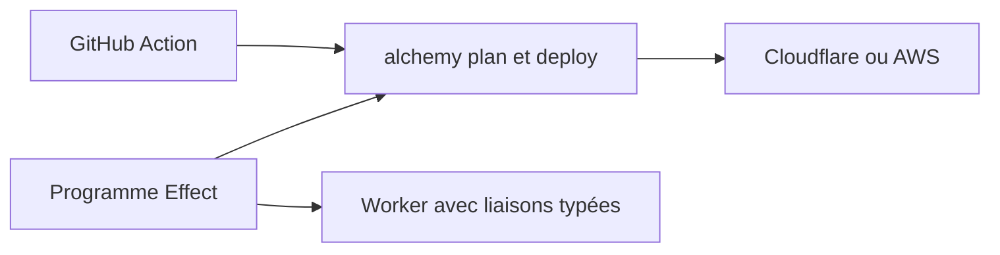

# alchemy-run/alchemy

> Une bibliothèque TypeScript qui décrit l'infrastructure cloud et le code applicatif dans un seul programme Effect.

## Le problème
L'infrastructure vit dans du YAML ou un second langage, séparée du code qui l'utilise, avec des câblages IAM à la main.

## Ce que ça fait vraiment
On déclare ressources et Workers ou Lambdas dans un programme Effect typé. Un appel comme `ReadWriteBucket(Uploads)` ajoute la liaison au déploiement et rend un client typé à l'exécution. Les erreurs d'API cloud sont des erreurs Effect typées. Cibles citées : AWS, Cloudflare, GCP, Fly, Hetzner, Kubernetes, Railway, Neon, PlanetScale, Stripe.

## Comment c'est branché
Schéma simplifié d'après la fiche, sans diagramme fourni.



## Essayer
```bash
pnpm add alchemy@latest effect @effect/platform-bun @effect/platform-node
```

## Coût et pièges
Le projet est gratuit, mais les ressources cloud déployées sont facturées par le fournisseur. Il faut un compte (par exemple Cloudflare, avec `CLOUDFLARE_API_TOKEN`).

## Ce que ce n'est pas
Pas stable : la v2 est en bêta et le README annonce des ruptures de compatibilité. Il faut aussi connaître Effect.

## Alternatives
Aucune alternative nommée dans le README.

## Pour toi
À surveiller : l'infrastructure en code typé séduit pour des pipelines MLOps sur Cloudflare ou AWS, mais la bêta et le coût d'entrée Effect justifient d'attendre.

