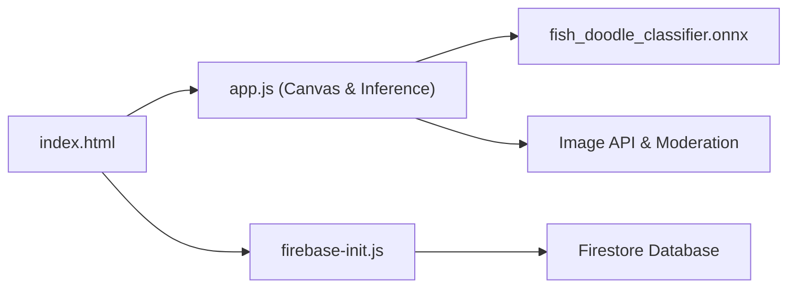

# aldenhallak/fishes

> Fish-drawing website where a neural network in the browser validates the drawings, with voting and a shared aquarium.

## The problem
A collaborative drawing game needs to filter off-topic drawings without sending every stroke to a server.

## What it actually does
The static front end (HTML/JS) runs an ONNX classifier via ONNX Runtime Web while you draw. Voting, profiles, personal aquariums and moderation go through Firebase/Firestore. A separate serverless backend (fish-be) processes the images, and fish-trainer trains the PyTorch model. The README says ~80% of the code is AI-generated.

## How it is wired


## Trying it
```bash
# Aucune commande documentée. Étapes du README : placer fish_doodle_classifier.onnx dans assets/models/,
# configurer src/js/firebase-init.js, déployer le site statique (Vercel, Netlify, Firebase Hosting).
```

## Cost and gotchas
Requires Firebase, a deployed fish-be backend (Cloud Run) and the ONNX model, which comes from another repository. Without a license, reuse is not permitted.

## What it is not
Not a reusable library: a demo site. The backend and training are in other repositories.

## Alternatives
No alternative named in the README.

## For you
Ignore: a nice example of in-browser ONNX inference, but unlicensed and incomplete without the linked repositories.
