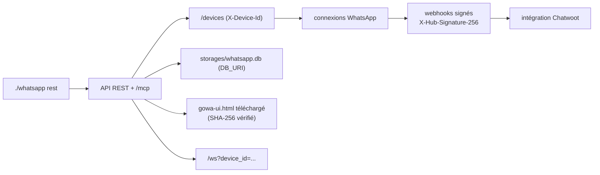

# aldinokemal/go-whatsapp-web-multidevice

> Go gateway that exposes several WhatsApp accounts as a REST API, webhooks and an MCP server.

## The problem
Automating sending and receiving WhatsApp messages from a backend has no accessible official API;
managing several accounts in a single process is even harder.

## What it actually does
`./whatsapp rest` serves both the REST API and the MCP server on `/mcp` — they have been unified since
v9. Several devices coexist in one instance: the `/devices` endpoints manage them, and
every scoped call requires an `X-Device-Id` header or a `device_id` parameter. It sends messages,
statuses, stickers (automatic conversion to 512×512 WebP), mentions including `@everyone`, with
image and video compression. Webhooks carry a top-level `device_id`, an HMAC-SHA-256
signature in `X-Hub-Signature-256`, filtering by event type and by JID, and
can be defined per device. Chatwoot integration with history import. The dashboard
is no longer in the repository: it is downloaded at startup, verified by SHA-256 fingerprint and served on `/`.

## How it is wired


## Trying it
```bash
./whatsapp rest
./whatsapp --help
cp src/.env.example src/.env
brew install ffmpeg webp
sudo apt update && sudo apt install ffmpeg webp
export CGO_CFLAGS_ALLOW="-Xpreprocessor"
```

## Cost and gotchas
Free but dependent on a service you do not control: a linked WhatsApp account, with a risk of
being banned that the README does not mention. FFmpeg and libwebp are required, Go 1.26+ to build.
An in-memory `DB_KEYS_URI` loses session state on restart. `--webhook-insecure-skip-verify`
disables TLS verification: for development only. The default webhook secret is `secret`.

## What it is not
Not an official WhatsApp API nor the Business API. Not a user interface: the dashboard lives in
another repository and is fetched at startup — a supply-chain point to pin via
`APP_UI_ASSET_SHA256`. The v6→v9 breaking changes are numerous: `rest` mode mandatory, MCP merged,
per-device scoping enforced.

## Alternatives
No named alternative: `gowa-ui` and Chatwoot are complements, not replacements.

## For you
The MCP endpoint makes it an interesting agent channel; isolate it from the network and do not wire it into production.
