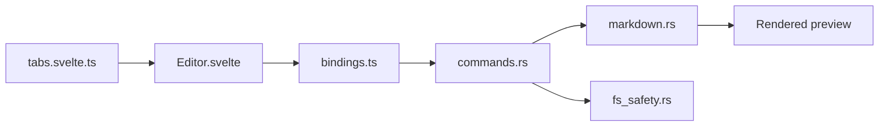

# alecdotdev/Markpad

> Desktop Markdown reader and editor (Tauri, Svelte, Monaco), with KaTeX and Mermaid.

## The problem
Reading and editing Markdown files with faithful rendering, math and diagrams, without a heavy editor.

## What it actually does
GitHub-style rendering, KaTeX, Mermaid, table of contents, Zen mode; editing in Monaco with Vim, split view, image pasting; tabs, multiple windows, restored session, automatic reload, HTML and PDF export. No telemetry, 26 languages. Windows, macOS, Linux.

## How it is wired


## Trying it
```bash
choco install markpad-app
brew install --cask markpad
sudo snap install markpad
npm install
npm run tauri build
```

## Cost and gotchas
Free. The `.deb` and `.rpm` packages do not update themselves (no apt/dnf repository). The test macOS build is unsigned.

## What it is not
Not a note-taking tool with a link database: a file reader/editor. The README does not compare it with other tools.

## Alternatives
No alternative named in the README.

## For you
Worth watching: handy for re-reading notes and READMEs with Mermaid and KaTeX, with no strategic stakes; try it only if your current editor bothers you.
