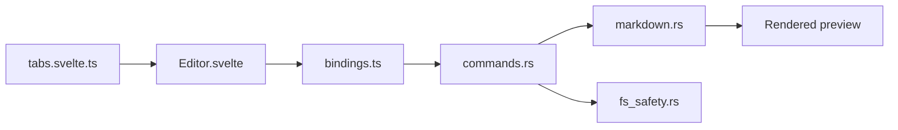

# alecdotdev/Markpad

> Lecteur et éditeur Markdown de bureau (Tauri, Svelte, Monaco), avec KaTeX et Mermaid.

## Le problème
Lire et éditer des fichiers Markdown avec rendu fidèle, maths et diagrammes, sans éditeur lourd.

## Ce que ça fait vraiment
Rendu style GitHub, KaTeX, Mermaid, table des matières, mode Zen ; édition dans Monaco avec Vim, vue scindée, collage d'images ; onglets, fenêtres multiples, session restaurée, rechargement automatique, export HTML et PDF. Sans télémétrie, 26 langues. Windows, macOS, Linux.

## Comment c'est branché


## Essayer
```bash
choco install markpad-app
brew install --cask markpad
sudo snap install markpad
npm install
npm run tauri build
```

## Coût et pièges
Gratuit. Les paquets `.deb` et `.rpm` ne se mettent pas à jour seuls (pas de dépôt apt/dnf). Build macOS de test non signé.

## Ce que ce n'est pas
Pas un outil de prise de notes avec base de liens : un lecteur/éditeur de fichiers. Le README ne compare pas avec d'autres outils.

## Alternatives
Aucune alternative nommée dans le README.

## Pour toi
À surveiller : pratique pour relire des notes et README avec Mermaid et KaTeX, sans enjeu stratégique ; à tester seulement si ton éditeur actuel te gêne.

