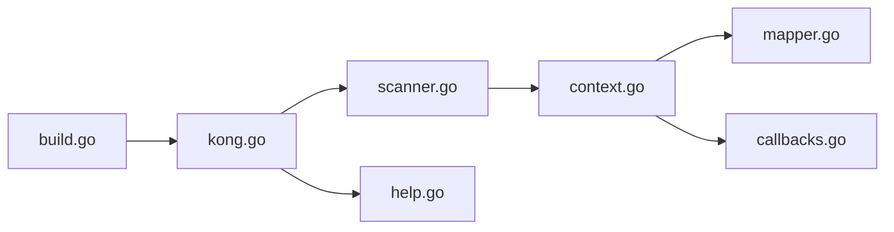

# alecthomas/kong

> Go command-line parser: the structure of the CLI is described by annotated structs.

## The problem
Writing nested CLIs in Go with the standard packages is verbose and repetitive.

## What it actually does
Builds a command model from a struct and its tags, parses the arguments, decodes the values (durations, files, URLs, maps, slices), validates, then calls `Run()` on the chosen command. Generated contextual help, hooks, plugins, dynamic commands, config loading (YAML, HCL, TOML, JSON), dependency injection. Version 1.0.0 released.

## How it is wired


## Trying it
```go
var CLI struct {
  Rm struct {
    Force     bool `help:"Force removal."`
    Paths []string `arg:"" name:"path" help:"Paths to remove." type:"path"`
  } `cmd:"" help:"Remove files."`
}

func main() {
  ctx := kong.Parse(&CLI)
}
```

## Cost and gotchas
Free. A breaking change (#436) comes with 1.0. The "switch on the command string" mode is fragile if the structure changes.

## What it is not
Not a full application framework: it only handles the command line.

## Alternatives
None cited in the README.

## For you
Good choice for writing a Go infra or MLOps tool with subcommands; otherwise irrelevant: adopt in that case.
