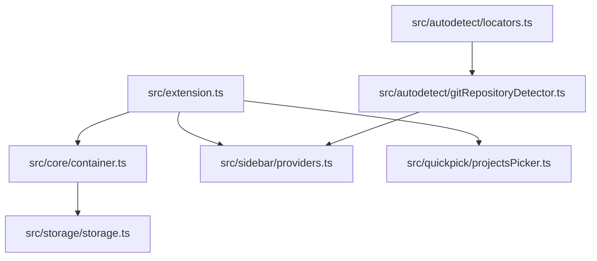

# alefragnani/vscode-project-manager

> VS Code extension to quickly find your project folders, saved or automatically detected.

## The problem
When you juggle many repositories, finding and reopening the right folder takes time.

## What it actually does
Saves a folder or workspace as a project, detects Git, Mercurial and SVN repositories in base folders, organizes by tags, shows a sidebar, a quick picker and the current project in the status bar. Projects are in an editable `projects.json` file.

## How it is wired


## Trying it
VS Code palette commands cited in the README:
```bash
Project Manager: Save Project
Project Manager: List Projects to Open
Project Manager: Filter Projects by Tag
```
Detection setting: `projectManager.git.baseFolders`.

## Cost and gotchas
Free, installed from the VS Code marketplace (or Open VSX). GPL-3.0 license: no effect for simple use.

## What it is not
Not a project manager in the sense of tasks or planning: just a list of folders to reopen.

## Alternatives
No alternative named in the README.

## For you
Adopt: zero cost and immediate gain if you open dozens of experiment repositories in VS Code.
