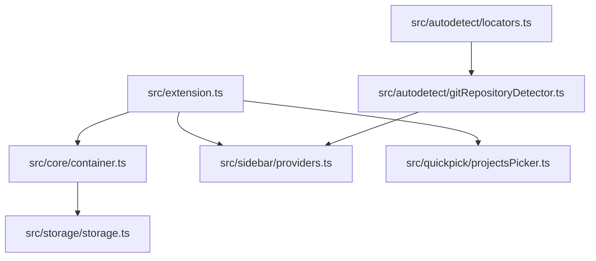

# alefragnani/vscode-project-manager

> Extension VS Code pour retrouver rapidement ses dossiers de projets, sauvegardés ou détectés automatiquement.

## Le problème
Quand on jongle avec beaucoup de dépôts, retrouver et rouvrir le bon dossier prend du temps.

## Ce que ça fait vraiment
Enregistre un dossier ou un workspace comme projet, détecte les dépôts Git, Mercurial et SVN dans des dossiers de base, organise par étiquettes, affiche une barre latérale, un sélecteur rapide et le projet courant en barre d'état. Les projets sont dans un fichier `projects.json` éditable.

## Comment c'est branché


## Essayer
Commandes de la palette VS Code citées dans le README :
```bash
Project Manager: Save Project
Project Manager: List Projects to Open
Project Manager: Filter Projects by Tag
```
Réglage de détection : `projectManager.git.baseFolders`.

## Coût et pièges
Gratuit, installation depuis la place de marché VS Code (ou Open VSX). Licence GPL-3.0 : sans effet pour un simple usage.

## Ce que ce n'est pas
Pas un gestionnaire de projet au sens tâches ou planning : seulement une liste de dossiers à rouvrir.

## Alternatives
Aucune alternative nommée dans le README.

## Pour toi
Adopter : coût nul et gain immédiat si tu ouvres des dizaines de dépôts d'expérimentation dans VS Code.

