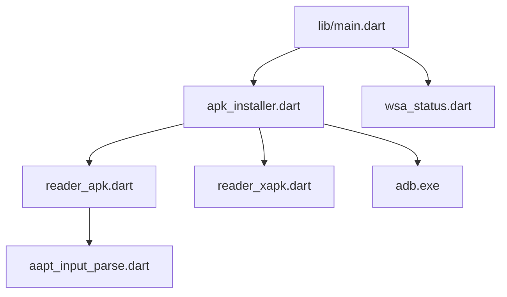

# alesimula/wsa_pacman

> Graphical installer for APK and XAPK files for the Windows Subsystem for Android.

## The problem
Installing an Android application in WSA goes through the adb command line.

## What it actually does
Double-clicking an `.apk` or `.xapk` opens a window that shows the package, icon, version and permissions, then installs, updates or downgrades. The application also opens the Android settings and the application management page. From the code (Flutter), it reads the package with aapt, installs with adb and checks WSA's state via the registry and WMI.

## How it is wired


## Trying it
```bash
# Aucune commande dans le README : installeur graphique, réglages décrits dans l'interface.
```

## Cost and gotchas
Free. WSA must be installed, with developer mode and USB debugging enabled; otherwise the application shows "Offline". WSA officially depends on Windows 11; Windows 10 goes through a cited third-party project.

## What it is not
It is not an app store: the Play Store is not officially supported by WSA. It only installs files you provide.

## Alternatives
No alternative named in the README (Aurora Store is cited as an unofficial Play Store client, not as an alternative).

## For you
Ignore: a convenience tool for Windows and Android, unrelated to your field.
