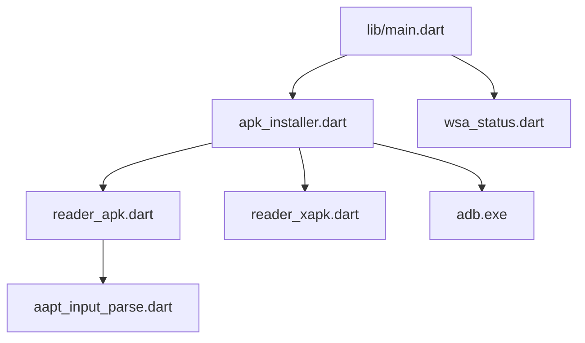

# alesimula/wsa_pacman

> Installeur graphique de fichiers APK et XAPK pour le sous-système Android de Windows.

## Le problème
Installer une application Android dans WSA passe par la ligne de commande adb.

## Ce que ça fait vraiment
Un double-clic sur un `.apk` ou `.xapk` ouvre une fenêtre qui affiche le paquet, l'icône, la version et les permissions, puis installe, met à jour ou rétrograde. L'application ouvre aussi les réglages Android et la page de gestion des applications. D'après le code (Flutter), elle lit le paquet avec aapt, installe avec adb et vérifie l'état de WSA via le registre et WMI.

## Comment c'est branché


## Essayer
```bash
# Aucune commande dans le README : installeur graphique, réglages décrits dans l'interface.
```

## Coût et pièges
Gratuit. Il faut WSA installé, le mode développeur et le débogage USB activés ; sinon l'application affiche « Offline ». WSA dépend de Windows 11 officiellement ; Windows 10 passe par un projet tiers cité.

## Ce que ce n'est pas
Ce n'est pas un magasin d'applications : le Play Store n'est pas pris en charge officiellement par WSA. Il n'installe que des fichiers que tu fournis.

## Alternatives
Aucune alternative nommée dans le README (Aurora Store est cité comme client Play Store non officiel, pas comme alternative).

## Pour toi
À ignorer : outil de confort pour Windows et Android, sans lien avec ton métier.

