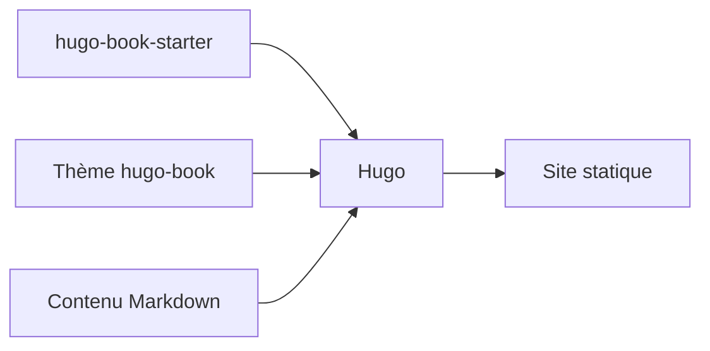

# alex-shpak/hugo-book

> A sober, book-style Hugo documentation theme for technical sites.

## The problem
A clean Hugo documentation site requires designing the navigation and layout.

## What it actually does
Provides a multilingual, lightweight, mobile-friendly theme with dark mode, shortcodes, comments, a blog and simple taxonomies. Main features work without JavaScript. Starts with no initial configuration.

## How it is wired


## Trying it
```bash
git clone https://github.com/alex-shpak/hugo-book-starter my-docs
cd my-docs
git submodule update --init --remote
hugo server --minify
```

## Cost and gotchas
Free. Hugo v0.158 or later. Versioned by minor number: breaking changes are expected between versions, so pin a release.

## What it is not
Not a site generator or a CMS: you need Hugo. No search or advanced features described in the README.

## Alternatives
No alternative named in the README.

## For you
Worth watching: a good choice to document a data project as a static site, but breaking changes between versions mean you must pin a release.
