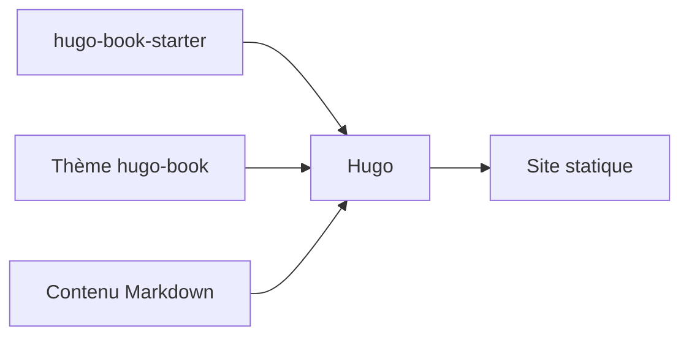

# alex-shpak/hugo-book

> Thème Hugo de documentation sobre en forme de livre, pour sites techniques.

## Le problème
Un site de documentation Hugo propre demande de concevoir navigation et mise en page.

## Ce que ça fait vraiment
Fournit un thème multilingue, léger, adapté au mobile, avec mode sombre, shortcodes, commentaires, blog et taxonomies simples. Fonctions principales sans JavaScript. Démarre sans configuration initiale.

## Comment c'est branché


## Essayer
```bash
git clone https://github.com/alex-shpak/hugo-book-starter my-docs
cd my-docs
git submodule update --init --remote
hugo server --minify
```

## Coût et pièges
Gratuit. Hugo v0.158 ou plus. Versionnement par numéro mineur : des ruptures sont attendues entre versions, donc fixer une release.

## Ce que ce n'est pas
Pas un générateur de site ni un CMS : il faut Hugo. Pas de recherche ou de fonctions avancées décrites dans le README.

## Alternatives
Aucune alternative nommée dans le README.

## Pour toi
À surveiller : bon choix pour documenter un projet data en site statique, mais les ruptures entre versions imposent de fixer une release.

