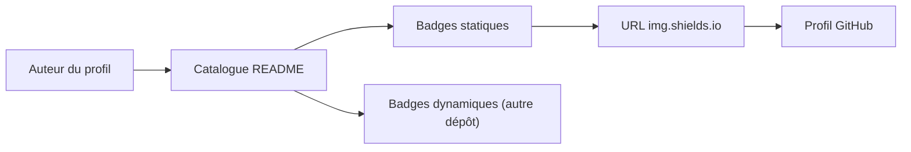

# alexandresanlim/Badges4-README.md-Profile

> A catalog of badge URLs to decorate a GitHub profile, for anyone who cares about their README.

## The problem
Composing consistent badges (logos, colors) for a GitHub profile means crafting each URL by hand.

## What it actually does
A huge README sorted by category: academic, analytics, AI (ChatGPT, Claude, PyTorch, TensorFlow…), cloud, databases, frameworks, languages, IDEs, OSes, social networks, etc. Each line gives the URL of an img.shields.io badge to paste into an image tag or in Markdown. A "Dynamic" section has been moved to another repository.

## How it is wired
No code: a catalog of URLs.


## Trying it
```bash
# Pas de commande : copier une URL du catalogue, par exemple

```

## Cost and gotchas
Free, MIT. The badges are served by img.shields.io: if that service is unavailable, the images disappear. A few URLs in the README contain typos.

## What it is not
Not a tool or a library: a list of URLs to copy. No automatic badge generator in the README.

## Alternatives
Shields.io and Simple Icons are cited as sources of the badges and logos.

## For you
Ignore: profile decoration, of no value for data/AI/MLOps work.
