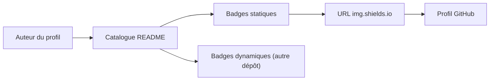

# alexandresanlim/Badges4-README.md-Profile

> Catalogue d'URL de badges pour décorer un profil GitHub, pour qui soigne son README.

## Le problème
Composer des badges homogènes (logos, couleurs) pour un profil GitHub demande de fabriquer chaque URL à la main.

## Ce que ça fait vraiment
Un README énorme classé par catégories : académique, analytique, IA (ChatGPT, Claude, PyTorch, TensorFlow…), cloud, bases de données, frameworks, langages, IDE, OS, réseaux sociaux, etc. Chaque ligne donne l'URL d'un badge img.shields.io à coller dans une balise image ou en Markdown. Une section « Dynamic » a été déplacée vers un autre dépôt.

## Comment c'est branché
Aucun code : un catalogue d'URL.


## Essayer
```bash
# Pas de commande : copier une URL du catalogue, par exemple

```

## Coût et pièges
Gratuit, MIT. Les badges sont servis par img.shields.io : si ce service est indisponible, les images disparaissent. Quelques URL du README contiennent des fautes de frappe.

## Ce que ce n'est pas
Pas un outil ni une bibliothèque : une liste d'URL à copier. Pas de générateur automatique de badges dans le README.

## Alternatives
Shields.io et Simple Icons sont cités comme sources des badges et des logos.

## Pour toi
Ignorer : décoration de profil, sans valeur pour un travail data/IA/MLOps.

