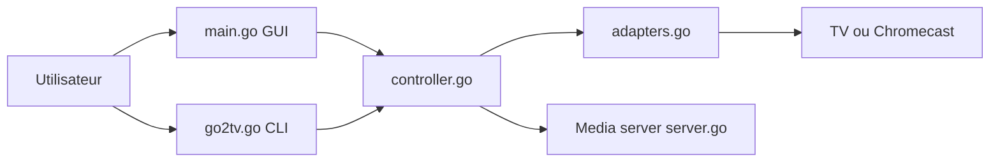

# alexballas/go2tv

> Sends local videos, music and images to a Smart TV or a Chromecast.

## The problem
Playing a local file on the television means going through a USB stick or a media server.

## What it actually does
Discovers DLNA/UPnP and Chromecast devices on the network, serves the file over HTTP, transcodes via FFmpeg if needed, and handles subtitles, playlists, seek, RTMP streams (OBS) and desktop casting. Interfaces: GUI, CLI and a web interface in server mode.

## How it is wired


## Trying it
```bash
brew install --cask go2tv
go2tv -l
go2tv -v movie.mkv -s movie.srt -tc -t http://192.168.1.100:8060/
go2tv -server -media-root /path/to/Media
```

## Cost and gotchas
Free. FFmpeg for transcoding. The Web UI's LAN mode is plain HTTP without TLS. UDP ports 3339-3438 and TCP ports 3500-4499 must be opened. Chromecast receiver hosted by the author.

## What it is not
Not a media server with an indexed library.

## Alternatives
No alternative cited; a companion MCP server, mcp-beam, uses the same core.

## For you
Ignore: a well-made consumer tool but unrelated to data, AI or MLOps.
