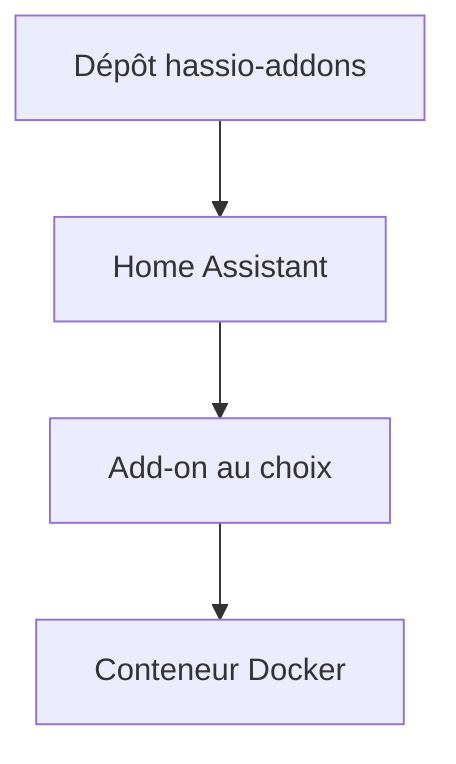

# alexbelgium/hassio-addons

> Repository of more than 140 Home Assistant add-ons (media library, photos, backup, network tools) for home installation.

## The problem
Home Assistant offers few ready-to-use self-hosted applications for a home server.

## What it actually does
Catalog of packaged add-ons: Immich, Plex, Jellyfin, Sonarr, Radarr, Vaultwarden, Nextcloud, Portainer, Postgres with VectorChord, AI tools (Letta Code, OmniRoute, Claude Desktop) and others. Some are marked obsolete or archived. The README gives installation statistics.

## How it is wired
Simplified diagram based on the sheet, no diagram provided.

## Trying it
No command: add the URL https://github.com/alexbelgium/hassio-addons as an add-on repository in Home Assistant.

## Cost and gotchas
Free, but requires a Home Assistant installation with supervisor. Each add-on has its own license and maintenance; some are discouraged (obsolete, deprecated).

## What it is not
Not a single application: it is a catalog. The Arpspoof add-on, the most installed, cuts the connection of devices on the local network.

## Alternatives
No alternative named in the README.

## For you
Ignore: useful for a homelab, outside the data / AI / MLOps scope, except for hosting Immich or Postgres at home.
