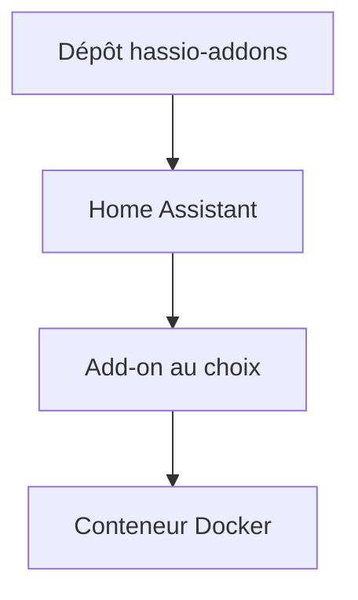

# alexbelgium/hassio-addons

> Dépôt de plus de 140 add-ons Home Assistant (médiathèque, photos, sauvegarde, outils réseau) pour installation domestique.

## Le problème
Home Assistant propose peu d'applications auto-hébergées prêtes à l'emploi pour un serveur domestique.

## Ce que ça fait vraiment
Catalogue d'add-ons packagés : Immich, Plex, Jellyfin, Sonarr, Radarr, Vaultwarden, Nextcloud, Portainer, Postgres avec VectorChord, outils d'IA (Letta Code, OmniRoute, Claude Desktop) et autres. Certains sont marqués obsolètes ou archivés. Le README donne des statistiques d'installation.

## Comment c'est branché
Schéma simplifié d'après la fiche, sans diagramme fourni.

## Essayer
Aucune commande : ajouter l'URL https://github.com/alexbelgium/hassio-addons comme dépôt d'add-ons dans Home Assistant.

## Coût et pièges
Gratuit, mais exige une installation Home Assistant avec superviseur. Chaque add-on a sa propre licence et sa maintenance ; certains sont déconseillés (obsolete, deprecated).

## Ce que ce n'est pas
Pas une application unique : c'est un catalogue. Le add-on Arpspoof, le plus installé, coupe la connexion d'appareils du réseau local.

## Alternatives
Aucune alternative nommée dans le README.

## Pour toi
Ignorer : utile pour un homelab, hors du périmètre data / IA / MLOps, sauf pour héberger Immich ou Postgres à la maison.

