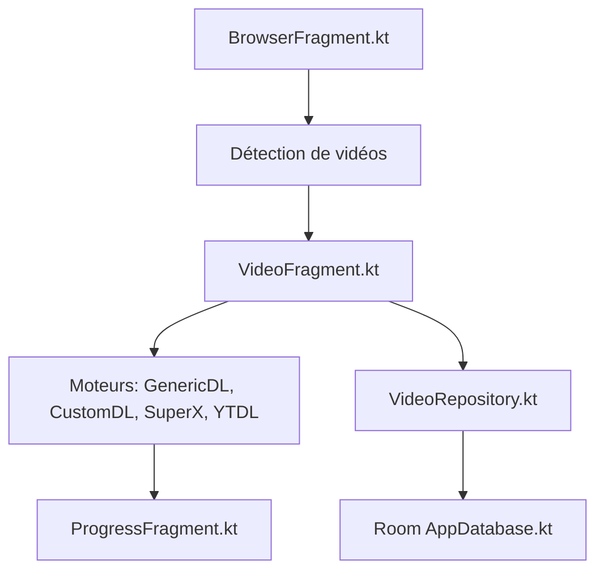

# alexch33/super-video-downloader

> Android app for downloading video and audio with a built-in browser, player and ad blocker.

## The problem
Downloading HLS, DASH or live streams from a phone often takes several apps.

## What it actually does
A WebView browser detects the media on a page, then four download engines (generic, files, SuperX segmented streams, youtube-dl) fetch them in the background. Room keeps the history, a proxy module handles HTTP/SOCKS and encrypted DNS, adblock-rust filters ads.

## How it is wired


## Trying it
```bash
git submodule update --init --recursive
./gradlew :app:assembleDebug
./gradlew :app:assembleRelease
```

## Cost and gotchas
Free. Building requires JDK 21, the Android SDK and NDK, Go and Rust. The README recommends F-Droid for installation.

## What it is not
Not a data or AI tool. The README states that the author disclaims all responsibility for illegal uses; respecting copyright is your responsibility.

## Alternatives
- youtube-dl-android (cuongpm): cited source of inspiration.

## For you
Ignore: consumer Android application unrelated to data, AI or MLOps work.
