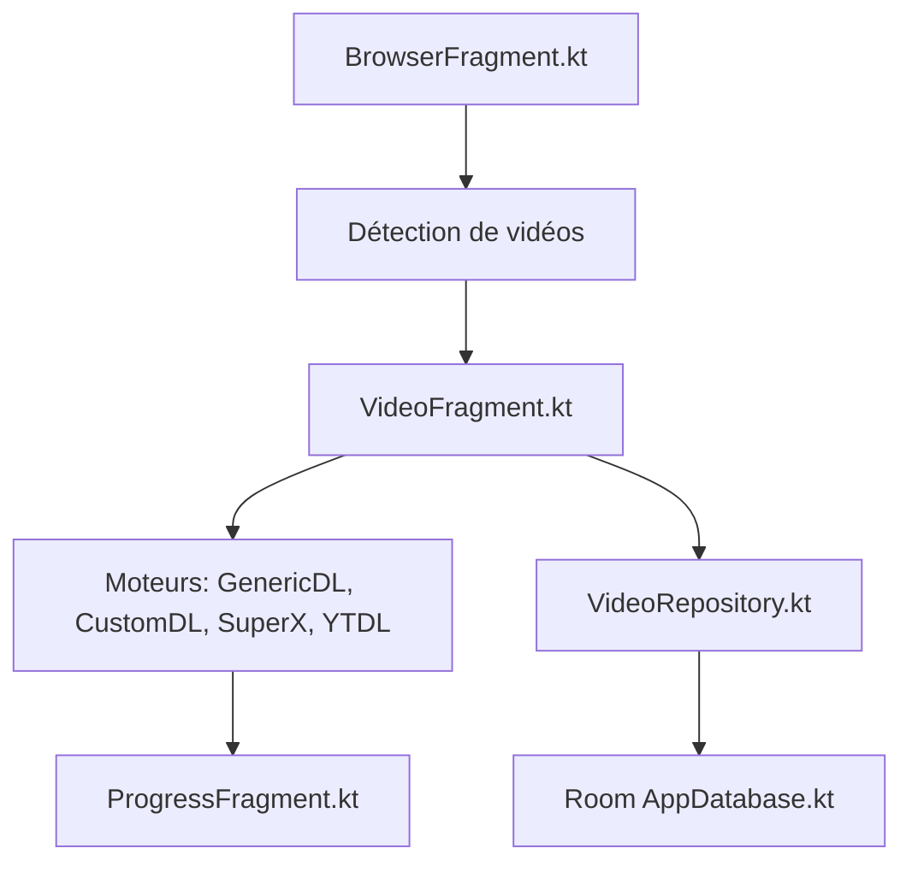

# alexch33/super-video-downloader

> Application Android de téléchargement de vidéos et audio avec navigateur intégré, lecteur et bloqueur de pubs.

## Le problème
Télécharger des flux HLS, DASH ou en direct depuis un téléphone demande souvent plusieurs applications.

## Ce que ça fait vraiment
Un navigateur WebView détecte les médias d'une page, puis quatre moteurs de téléchargement (générique, fichiers, flux segmentés SuperX, youtube-dl) les récupèrent en tâche de fond. Room garde l'historique, un module proxy gère HTTP/SOCKS et DNS chiffré, adblock-rust filtre les pubs.

## Comment c'est branché


## Essayer
```bash
git submodule update --init --recursive
./gradlew :app:assembleDebug
./gradlew :app:assembleRelease
```

## Coût et pièges
Gratuit. Construire demande JDK 21, SDK et NDK Android, Go et Rust. Le README recommande F-Droid pour l'installation.

## Ce que ce n'est pas
Pas un outil de data ou d'IA. Le README rappelle que l'auteur décline toute responsabilité sur les usages illégaux ; le respect des droits d'auteur reste à ta charge.

## Alternatives
- youtube-dl-android (cuongpm) : source d'inspiration citée.

## Pour toi
Ignorer : application grand public Android sans lien avec un travail data, IA ou MLOps.

