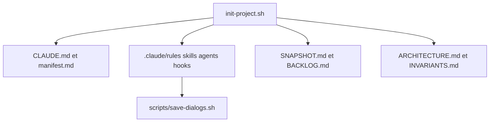

# alexeykrol/claude-code-starter

> Starter environment for projects driven by Claude Code: rules, skills, agents, hooks and project memory.

## The problem
In a project run with an agent, instructions pile up in a giant `CLAUDE.md` and memory is lost between sessions.

## What it actually does
An `init-project.sh` installer detects the case (new, existing, legacy) and the type (code, content, hybrid). It adds a `.claude/` folder with rules, skills, agents, hooks, and a two-axis memory: contracts (`ARCHITECTURE.md`, `INVARIANTS.md`) and state (`SNAPSHOT.md`, `BACKLOG.md`). Version 6.3.0 introduces an orchestrator model. A script archives the JSONL dialogues.

## How it is wired

Simplified diagram based on the sheet, no diagram provided.

## Trying it
```bash
chmod +x init-project.sh
./init-project.sh
bash /absolute/path/to/claude-code-starter/scripts/install-global.sh
scripts/switch-repo-access.sh public --commit
```

## Cost and gotchas
Free, with bash and git; python3 recommended to merge `settings.json`. No license. README in Russian. `switch-repo-access.sh` does not rewrite git history, and the hooks are guardrails, not strict enforcement.

## What it is not
Not an application generator: it structures the agent's working environment. Imposes a working model and many files.

## Alternatives
None named in the README.

## For you
Useful if you work a lot with Claude Code and want a structured project memory; the missing license and the effect of imposing a method suggest watching before adopting.
