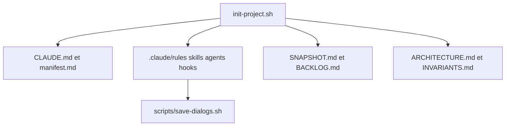

# alexeykrol/claude-code-starter

> Environnement de démarrage pour projets pilotés par Claude Code : règles, skills, agents, hooks et mémoire de projet.

## Le problème
Dans un projet mené avec un agent, les instructions s'entassent dans un `CLAUDE.md` géant et la mémoire se perd entre sessions.

## Ce que ça fait vraiment
Un installateur `init-project.sh` détecte le cas (nouveau, existant, ancien) et le type (code, contenu, hybride). Il ajoute un dossier `.claude/` avec règles, skills, agents, hooks, et une mémoire à deux axes : contrats (`ARCHITECTURE.md`, `INVARIANTS.md`) et état (`SNAPSHOT.md`, `BACKLOG.md`). La version 6.3.0 introduit un modèle d'orchestrateur. Un script archive les dialogues JSONL.

## Comment c'est branché

Schéma simplifié d'après la fiche, sans diagramme fourni.

## Essayer
```bash
chmod +x init-project.sh
./init-project.sh
bash /absolute/path/to/claude-code-starter/scripts/install-global.sh
scripts/switch-repo-access.sh public --commit
```

## Coût et pièges
Gratuit, avec bash et git ; python3 recommandé pour fusionner `settings.json`. Licence absente. README en russe. `switch-repo-access.sh` ne réécrit pas l'historique git, et les hooks sont des garde-fous, pas une application stricte.

## Ce que ce n'est pas
Pas un générateur d'application : il structure l'environnement de travail de l'agent. Impose un modèle de travail et beaucoup de fichiers.

## Alternatives
Aucune nommée dans le README.

## Pour toi
Utile si tu travailles beaucoup avec Claude Code et veux une mémoire de projet structurée ; la licence absente et l'effet d'imposer une méthode incitent à surveiller avant d'adopter.

