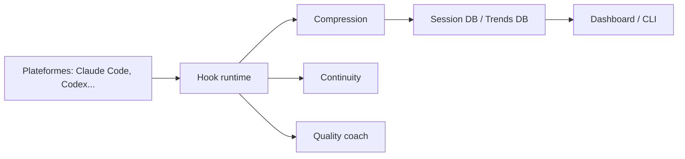

# alexgreensh/token-optimizer

> Plugin that reduces tokens wasted by coding assistants and saves context between sessions.

## The problem
Coding assistants burn tokens on re-reads, verbose outputs and bloated configs, and lose context at each compaction.

## What it actually does
Hooks intercept Read and Bash calls before they enter the context: diff on re-read, file skeleton, condensed outputs, large results archived on disk and retrievable (`expand`). It checkpoints before compaction and restores afterwards. Everything is stored in two local SQLite databases, with an HTML dashboard. The README claims no telemetry and no network calls.

## How it is wired


## Trying it
```bash
/plugin marketplace add alexgreensh/token-optimizer
/plugin install token-optimizer@alexgreensh-token-optimizer
```
Then `/token-optimizer` in Claude Code.

## Cost and gotchas
Free for personal use, research and small teams (fewer than 5 people or $20k/month); commercial license beyond that. The quantified gains are the author's own, partly estimated and not measured. Windows: plugin only.

## What it is not
Not software under a standard open-source license: license not identified by GitHub, with commercial conditions. Not an API billing tool.

## Alternatives
- Headroom, RTK, JFrog Boost, context-mode: cited in a comparison table (mostly output compression).

## For you
Watch: interesting if you use Claude Code heavily, but license with commercial clauses and a single maintainer.
