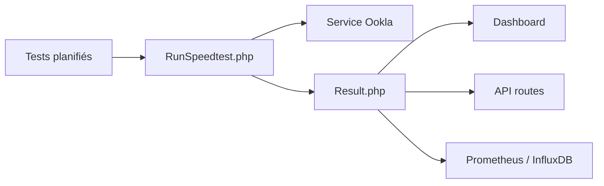

# alexjustesen/speedtest-tracker

> Self-hosted application that regularly measures internet speed and keeps the history.

## The problem
One-off speed measurements show neither trends nor outages, and nothing warns you when the connection degrades.

## What it actually does
It schedules Ookla tests, stores speed, ping and packet loss, displays a dashboard and charts, exposes a results API and alerts below a threshold. From the code: Prometheus and InfluxDB export, notification channels. The Docker image is built by LinuxServer.io.

## How it is wired

## Trying it
No command in the README: it points to the installation guide (Docker, Synology, Unraid).

## Cost and gotchas
Free; consumes bandwidth at each test. Depends on the Ookla service.

## What it is not
Not a general monitoring tool; it only measures the speed of your line.

## Alternatives
No alternative named in the README.

## For you
Worth watching: the Prometheus export fits into an observability stack, but this is homelab, not MLOps.
