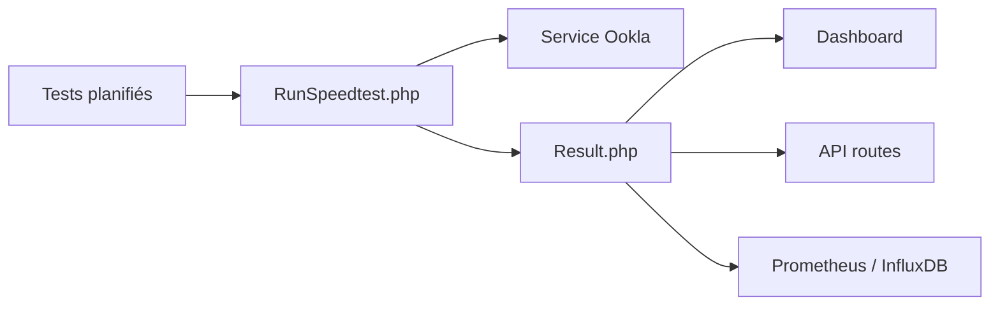

# alexjustesen/speedtest-tracker

> Application auto-hébergée qui mesure régulièrement le débit internet et conserve l'historique.

## Le problème
Les mesures de débit ponctuelles ne montrent ni les tendances ni les coupures, et rien ne prévient quand la connexion se dégrade.

## Ce que ça fait vraiment
Elle planifie des tests Ookla, stocke débit, ping et perte de paquets, affiche tableau de bord et courbes, expose une API de résultats et alerte sous un seuil. D'après le code : export Prometheus et InfluxDB, canaux de notification. L'image Docker est construite par LinuxServer.io.

## Comment c'est branché

## Essayer
Aucune commande dans le README : renvoi vers le guide d'installation (Docker, Synology, Unraid).

## Coût et pièges
Gratuit ; consomme de la bande passante à chaque test. Dépend du service Ookla.

## Ce que ce n'est pas
Pas un outil de supervision générale ; il mesure uniquement le débit de ta ligne.

## Alternatives
Aucune alternative nommée dans le README.

## Pour toi
À surveiller : l'export Prometheus s'intègre à une pile d'observabilité, mais c'est du homelab, pas du MLOps.

