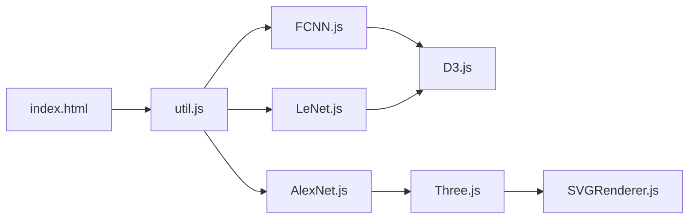

# alexlenail/NN-SVG

> Web tool that draws parameterizable neural network diagrams and exports them as SVG.

## The problem
Architecture figures for papers or slides are drawn by hand, slowly, with every layer change.

## What it actually does
Three styles: fully connected network, LeNet-style CNN (D3), AlexNet-style deep network (Three.js).
Sizes, colors and layout adjustable through parameters.
SVG export for papers or web pages; static site, everything runs in the browser.

## How it is wired

## Trying it
No command in the README: the tool is used in the browser.

## Cost and gotchas
Free, nothing to install. Short README: parameters and limits not detailed.

## What it is not
Not a generator from a PyTorch or Keras model: you enter the architecture by hand. Does not cover transformers.

## Alternatives
- vdumoulin/conv_arithmetic: illustrations of convolutions.
- TensorSpace: interactive 3D visualization of networks.

## For you
Adopt for presentation material: clean MLP or CNN figures in two minutes, with nothing to install.
