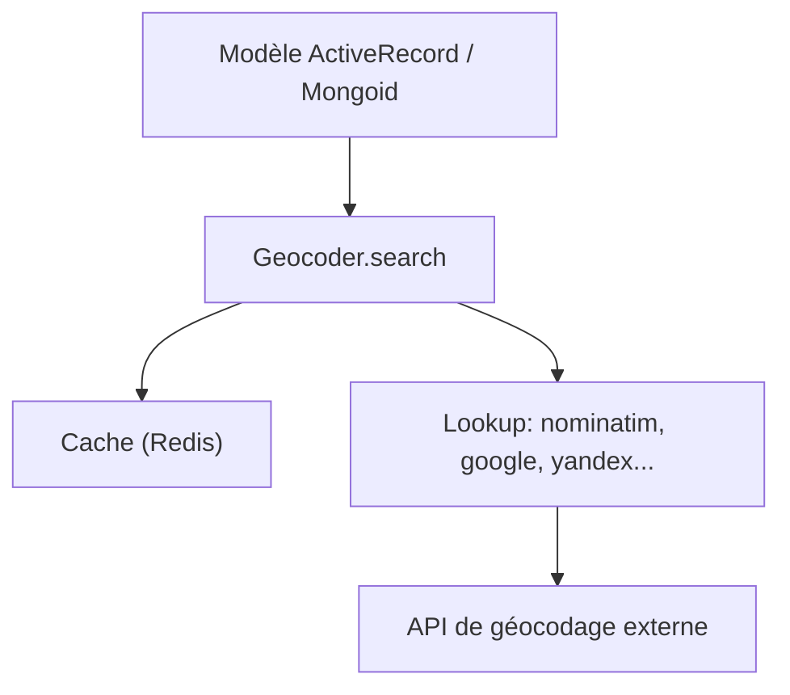

# alexreisner/geocoder

> Ruby gem for forward, reverse and IP-address geocoding, through more than forty APIs.

## The problem
Converting addresses, coordinates and IPs into places depends on highly variable services, each with its own format.

## What it actually does
Looks up address to coordinates and the reverse, and locates an IP. Integrates with ActiveRecord and Mongoid with radius, bounding-box or ring queries. Handles caching (Redis or other), a test mode with stubs, error handling and a Rake task for batch geocoding. Provides a `geocode` command. By default: Nominatim for addresses and ipinfo.io for IPs.

## How it is wired
Simplified diagram based on the sheet, no diagram provided.



## Trying it
```bash
rails generate geocoder:config
rake geocode:all CLASS=YourModel
geocode 29.951,-90.081
```

## Cost and gotchas
Accuracy and quotas depend on the chosen service, and some require a paid API key. Respect the terms of use before caching. `request.location` can be spoofed through HTTP headers. README truncated in the material provided.

## What it is not
Not a geodata provider: without an external API, it geocodes nothing. SQLite calculations are imprecise.

## Alternatives
- rgeo: cited for more advanced geospatial queries.

## For you
Ignore: it targets Ruby; in Python you would use other geocoding clients, and the dependency on an external service is the same.
