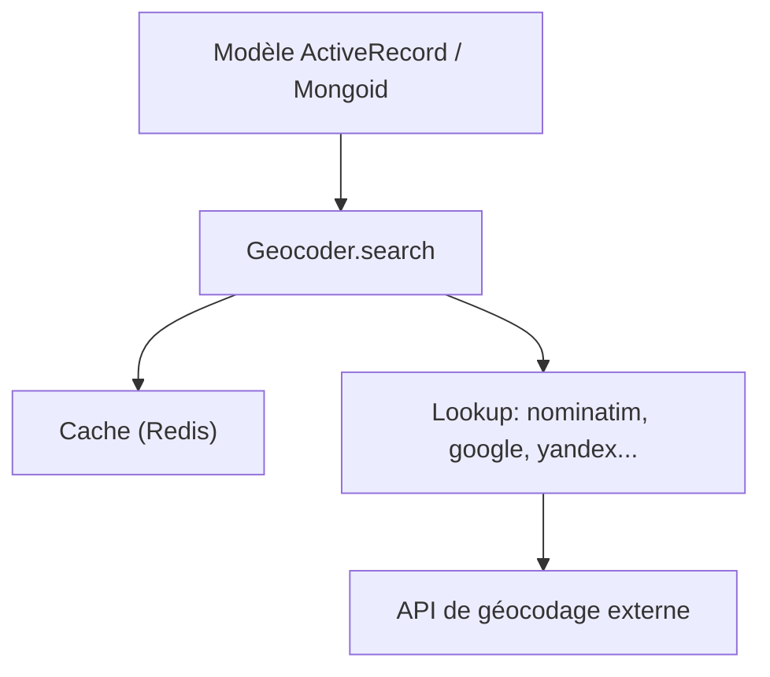

# alexreisner/geocoder

> Gem Ruby de géocodage direct, inverse et par adresse IP, via plus de quarante API.

## Le problème
Convertir adresses, coordonnées et IP en lieux dépend de services très variables, chacun avec son format.

## Ce que ça fait vraiment
Recherche adresse vers coordonnées et l'inverse, et localise une IP. S'intègre à ActiveRecord et Mongoid avec requêtes par rayon, rectangle ou anneau. Gère cache (Redis ou autre), mode test avec stubs, gestion d'erreurs et tâche Rake de géocodage par lot. Fournit une commande `geocode`. Par défaut : Nominatim pour les adresses et ipinfo.io pour les IP.

## Comment c'est branché
Schéma simplifié d'après la fiche, sans diagramme fourni.



## Essayer
```bash
rails generate geocoder:config
rake geocode:all CLASS=YourModel
geocode 29.951,-90.081
```

## Coût et pièges
La précision et les quotas dépendent du service choisi, certains exigent une clé d'API payante. Respecter les conditions d'utilisation avant de mettre en cache. `request.location` est falsifiable via les en-têtes HTTP. README tronqué dans la matière fournie.

## Ce que ce n'est pas
Pas un fournisseur de géodonnées : sans API externe, il ne géocode rien. Les calculs SQLite sont peu précis.

## Alternatives
- rgeo : cité pour des requêtes géospatiales plus avancées.

## Pour toi
À ignorer : cible Ruby ; en Python tu utiliseras d'autres clients de géocodage, la dépendance à un service externe est la même.

