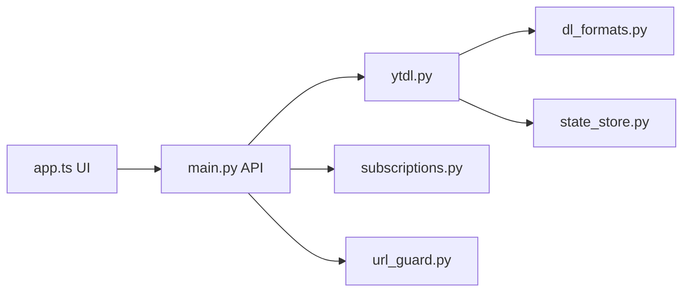

# alexta69/metube

> Self-hosted web interface for yt-dlp, to download videos, audio and playlists.

## The problem
yt-dlp is a command-line tool; driving downloads from several devices requires an interface.

## What it actually does
Angular interface that sends URLs to a Python API; the yt-dlp engine downloads videos, audio, subtitles, thumbnails, playlists and channels, with a persistent queue, subscriptions checked periodically, filename templates, option presets, uploadable cookies. Docker images are updated automatically at yt-dlp's pace. SSRF protection for private addresses, enabled by default.

## How it is wired


## Trying it
```bash
docker run -d -p 8081:8081 -v /path/to/downloads:/downloads ghcr.io/alexta69/metube
```

## Cost and gotchas
Free, AGPL-3.0 license. Allowing yt-dlp options per download (`ALLOW_YTDL_OPTIONS_OVERRIDES`) can allow command execution: reserve it for trusted environments. `CORS_ALLOWED_ORIGINS=*` should be handled with care. Respect the terms of the targeted sites.

## What it is not
Not a library manager: post-download management and tagging are out of scope, by design.

## Alternatives
beets, MusicBrainz Picard, Lidarr: tagging and organizing downloaded music.

## For you
Useful for building an audio/video corpus (transcription, datasets) on a personal server; trivial deployment, to be adopted with legal care.
