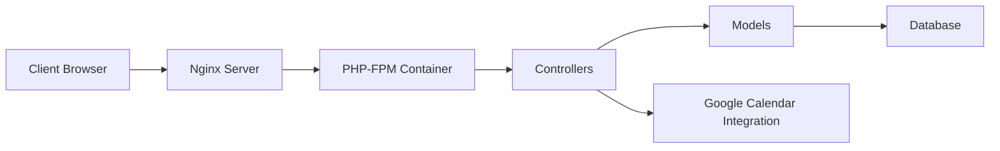

# alextselegidis/easyappointments

> Self-hosted appointment booking platform in PHP for small businesses.

## The problem
Let customers book online without a SaaS service or handing over their data.

## What it actually does
Management of appointments, customers, services and providers, working plans, Google Calendar sync, email notifications, multilingual support, REST API (`api/v1`). From the code: CodeIgniter MVC, Docker Compose with Nginx and PHP-FPM, LDAP, CalDAV, webhooks. Paid premium features are advertised on the author's website.

## How it is wired


## Trying it
```bash
git clone https://github.com/alextselegidis/easyappointments.git
cd easyappointments
docker compose up
docker compose exec php-fpm bash
npm install && composer install
npm start
```

## Cost and gotchas
Free; PHP 8.2+, MySQL, Apache or Nginx in production. Advanced features are paid separately.

## What it is not
Not a SaaS: you have to host and maintain it. GPL-3.0 license (copyleft).

## Alternatives
No alternative named in the README.

## For you
Ignore: a PHP appointment booking tool, unrelated to data/AI/MLOps.
