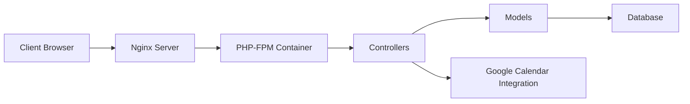

# alextselegidis/easyappointments

> Plateforme auto-hébergée de prise de rendez-vous en PHP pour petites entreprises.

## Le problème
Permettre à des clients de réserver en ligne sans service SaaS ni cession de données.

## Ce que ça fait vraiment
Gestion des rendez-vous, clients, services et prestataires, plans de travail, synchronisation Google Calendar, notifications e-mail, multilingue, API REST (`api/v1`). D'après le code : CodeIgniter MVC, Docker Compose avec Nginx et PHP-FPM, LDAP, CalDAV, webhooks. Des fonctions premium payantes sont annoncées sur le site de l'auteur.

## Comment c'est branché


## Essayer
```bash
git clone https://github.com/alextselegidis/easyappointments.git
cd easyappointments
docker compose up
docker compose exec php-fpm bash
npm install && composer install
npm start
```

## Coût et pièges
Gratuit ; PHP 8.2+, MySQL, Apache ou Nginx en production. Fonctions avancées payantes à part.

## Ce que ce n'est pas
Pas un SaaS : il faut l'héberger et le maintenir. Licence GPL-3.0 (copyleft).

## Alternatives
Aucune alternative nommée dans le README.

## Pour toi
À ignorer : outil de prise de rendez-vous PHP, sans rapport avec data/IA/MLOps.

