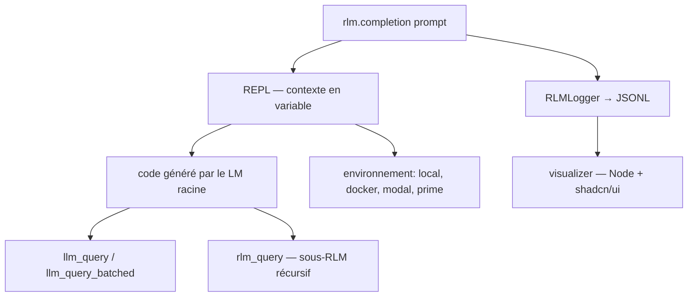

# alexzhang13/rlm

> Recursive language models: the context becomes a variable in a REPL.

## The problem
A very long context does not fit in a window, and splitting it by hand loses the structure.
Sub-agents passed through JSON tool-calling make rigid what should be code.

## What it actually does
It replaces `llm.completion(prompt, model)` with `rlm.completion(prompt, model)`: the context is dropped as a variable in a REPL that the model inspects and decomposes itself.
Sub-calls are functions in the code (`llm_query`, `llm_query_batched`, `rlm_query`, `rlm_query_batched`), not JSON tools, with parallelism bounded by `max_concurrent_subcalls`.
Seven REPL environments are supported: `local` (via `exec`, same venv as the host), `ipython`, `docker`, `modal`, `prime`, `daytona`, `e2b`.
A `training/` folder exposes `rlm.RLM` as a `verifiers` environment pluggable into prime-rl, with an OOLONG example (long-context QA).

## How it is wired


## Trying it
```bash
pip install rlms
make quickstart
uv add modal && modal setup
uv pip install -e ".[prime]" && export PRIME_API_KEY=...
```

## Cost and gotchas
Python 3.11+ and a provider key; recursive sub-calls multiply requests, hence the bill, with no announced bound beyond `max_concurrent_subcalls`.
The default `local` environment runs generated code in the host process: the README advises against it for production and for any context containing untrusted input. Prime sandboxes are in beta and slow.

## What it is not
It is not a product: it is the inference code of a paper (MIT OASYS lab), openly presented as a bet on a future way of designing "language models".
Nor is it a guaranteed gain — the list of "in the wild" uses points to third-party demos and posts, not to measurements.

## Alternatives
- DSPy.RLM: implementation cited in the DSPy ecosystem.
- `viplismism/rlm-cli`: a CLI for RLM, cited in the README.
- `context-labs/HALO`: agent optimization loop built on RLM.

## For you
The "context as REPL variable" pattern deserves your attention; keep `local` away from anything touching untrusted data.
