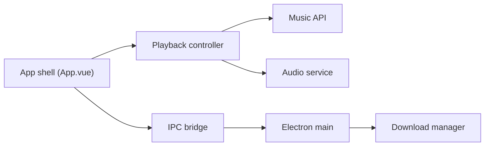

# algerkong/AlgerMusicPlayer

> Third-party Vue/Electron music player, with desktop lyrics and downloads, for Chinese-speaking users.

## The problem
Listening to and organizing an online music catalog with lyrics, favorites and downloads outside the official clients.

## What it actually does
Vue + Electron application (desktop, web, mobile web): recommendations, history, favorites, immersive lyrics and a lyrics window, equalizer, timer, downloads. Source resolution relies on @unblockneteasemusic/server and netease-cloud-music-api running locally. README in Chinese.

## How it is wired


## Trying it
```bash
npm install
npm run dev
```

## Cost and gotchas
Free. Depends on unofficial third-party music APIs: can break without notice. The disclaimer forbids commercial use even though the license is MIT.

## What it is not
Not a streaming service: it bypasses/queries third-party sources. The text specifies "learning use only".

## Alternatives
No alternative named in the README.

## For you
Ignore: unrelated to data/AI/MLOps and relies on unofficial APIs of unclear legal status.
