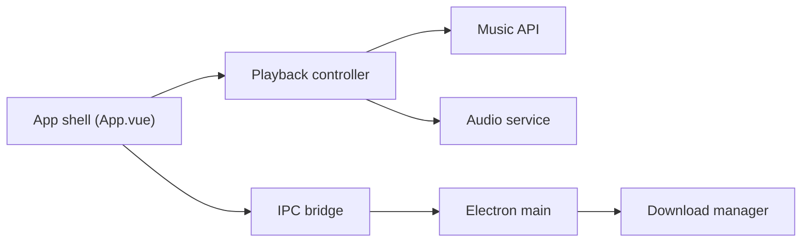

# algerkong/AlgerMusicPlayer

> Lecteur de musique Vue/Electron tiers, avec parole desktop et téléchargement, pour utilisateurs sinophones.

## Le problème
Écouter et organiser un catalogue de musique en ligne avec lyrics, favoris et téléchargement hors des clients officiels.

## Ce que ça fait vraiment
Application Vue + Electron (desktop, web, mobile web) : recommandations, historique, favoris, paroles immersives et fenêtre de paroles, égaliseur, minuteur, téléchargement. La résolution des sources s'appuie sur @unblockneteasemusic/server et netease-cloud-music-api en local. README en chinois.

## Comment c'est branché


## Essayer
```bash
npm install
npm run dev
```

## Coût et pièges
Gratuit. Dépend d'API tierces non officielles de musique : peut casser sans préavis. La déclaration interdit l'usage commercial alors que la licence est MIT.

## Ce que ce n'est pas
Pas un service de streaming : il contourne/interroge des sources tierces. Le texte précise « usage d'apprentissage uniquement ».

## Alternatives
Aucune alternative nommée dans le README.

## Pour toi
À ignorer : sans rapport avec data/IA/MLOps et reposant sur des API non officielles à statut juridique flou.

