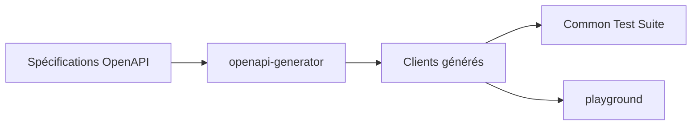

# algolia/api-clients-automation

> Repository that generates Algolia's API clients in several languages from OpenAPI specifications.

## The problem
Maintaining one client per language by hand for the same API creates discrepancies and repeated work.

## What it actually does
Generates Algolia's API clients from OpenAPI specifications with openapi-generator. A command-line interface runs the generation, build, common test (CTS) and publication commands in a Docker container. A playground lets you try the generated clients.

## How it is wired


## Trying it
```bash
nvm use && yarn
yarn docker:setup
```

## Cost and gotchas
Docker and Node required. The generated clients only serve Algolia's paid service, with a key and an account.

## What it is not
It is not a ready-to-install client: it is the factory that produces them. Nor is it a generator usable for another API without adaptation.

## Alternatives
- openapi-generator: the underlying generation tool.

## For you
Ignore: Algolia's internal tooling, with no direct use for a data, AI or MLOps profile; use the published clients instead.
