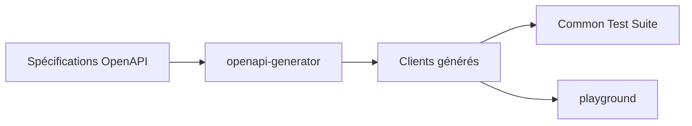

# algolia/api-clients-automation

> Dépôt qui génère les clients d'API d'Algolia dans plusieurs langages à partir de spécifications OpenAPI.

## Le problème
Maintenir à la main un client par langage pour une même API crée des écarts et du travail répété.

## Ce que ça fait vraiment
Génère les clients d'API d'Algolia depuis des spécifications OpenAPI avec openapi-generator. Une interface en ligne de commande lance les commandes de génération, de build, de tests communs (CTS) et de publication dans un conteneur Docker. Un playground permet d'essayer les clients générés.

## Comment c'est branché


## Essayer
```bash
nvm use && yarn
yarn docker:setup
```

## Coût et pièges
Docker et Node requis. Les clients générés ne servent que le service payant Algolia, avec une clé et un compte.

## Ce que ce n'est pas
Ce n'est pas un client prêt à installer : c'est l'usine qui les produit. Ce n'est pas un générateur utilisable pour une autre API sans adaptation.

## Alternatives
- openapi-generator : l'outil de génération sous-jacent.

## Pour toi
À ignorer : outillage interne d'Algolia, sans usage direct pour un profil data, IA ou MLOps ; utilise plutôt les clients publiés.

