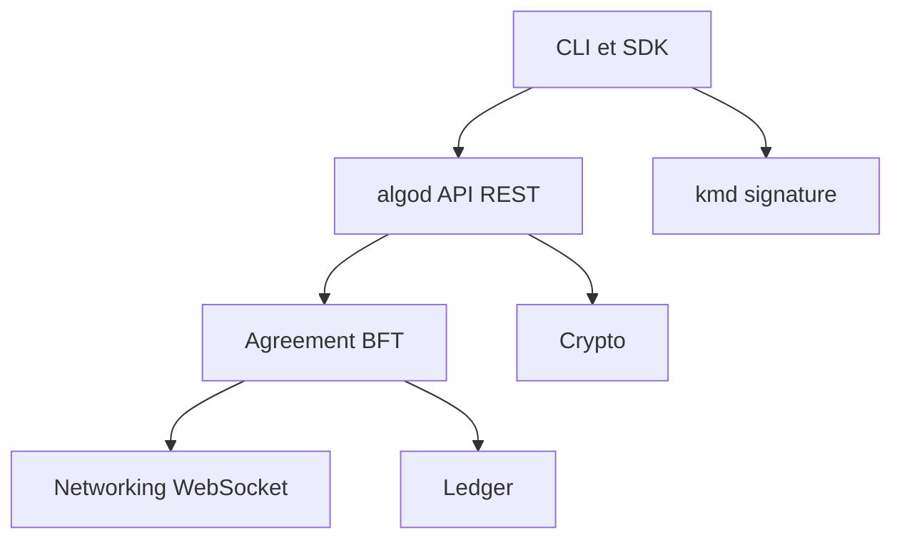

# algorand/go-algorand

> Official Go implementation of Algorand, a proof-of-stake blockchain: node, key daemon and tools.

## The problem
Taking part in the Algorand network or testing it locally requires a node that applies the consensus protocol and exposes an API.

## What it actually does
The repository provides the `algod` daemon (participating node, REST API) and `kmd` (isolated signing, usable on an offline machine). It also contains the crypto, ledger, Byzantine agreement and WebSocket network layers, plus `goal` and `carpenter`. The genesis files for mainnet, testnet and betanet are included.

## How it is wired


## Trying it
```bash
git clone https://github.com/algorand/go-algorand
cd go-algorand
./scripts/configure_dev.sh
make install
make test
${GOPATH}/bin/goal node start -d ~/.algorand
${GOPATH}/bin/carpenter -d ~/.algorand
```

## Cost and gotchas
Ubuntu 24.04 is the official target; macOS requires Homebrew. Go build via `make`. The license is present but GitHub does not identify it: read it before any use.

## What it is not
Neither an application SDK nor a data tool: it is node software. Detailed installation instructions live on the developer site, not here.

## Alternatives
No alternative named in the README.

## For you
Ignore: a blockchain node has no role in a data, AI or MLOps workflow, and the license remains to be checked.
