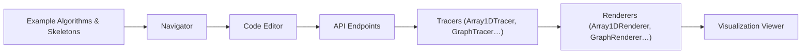

# algorithm-visualizer/algorithm-visualizer

> Interactive web platform that animates algorithms from code, for students and teachers.

## The problem
An algorithm is hard to understand by reading; you need to see its steps.

## What it actually does
React application: the editor sends code, tracers capture its visualization commands, and renderers (1D/2D arrays, graphs, charts, scatter plot, Markdown, log) display them. The algorithms and the tracing libraries live in separate repositories of the organization. Online demo at algorithm-visualizer.org.

## How it is wired

The architecture text is a partly assumed drawing guide.

## Trying it
No command documented. Open the online demo at algorithm-visualizer.org.

## Cost and gotchas
Free, no installation. Last push in June 2024, i.e. more than a year ago; some README sections (languages and frameworks) are empty.

## What it is not
It is not a development or profiling tool: it illustrates classic algorithms, not your production code nor data pipelines.

## Alternatives
No alternative named in the README.

## For you
Ignore: educational value only and a barely active project; nothing useful for everyday data/AI work.
