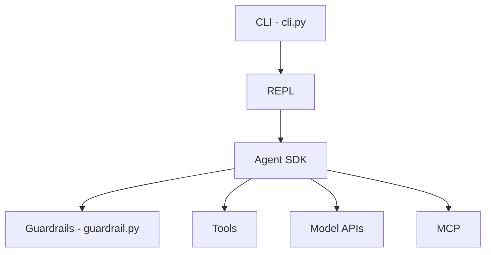

# aliasrobotics/cai

> Python agent framework for offensive and defensive security, archived, with 18 associated research papers.

## The problem
Evaluating what LLM agents can do in security (CTF, bug bounty, OT, robotics) requires a common, measurable and reproducible framework.

## What it actually does
An agent SDK (ReAct loop, Runner, handoffs, guardrails, tracing, MCP, voice) under a CLI/REPL, with a catalog of security agents (red team, blue team, DFIR, reverse engineering…) and tools by domain. The model is an external service: OpenAI, Anthropic, Ollama, etc. The repository is reduced to a single archive commit (v1.1.5 tree, pro version); the frozen public version is `cai-framework` 0.5.10 on PyPI.

## How it is wired


## Trying it
```bash
python3.12 -m venv cai_env
source cai_env/bin/activate
pip install cai-framework
```
The README adds a `.env` with the key of the chosen provider; the code block is truncated at that point.

## Cost and gotchas
Provider API key at your expense. The v1.1.5 tree is a paid distribution; `CAI_LICENSE_OFF=1` targets the public package. License not identified by GitHub. No fixes or security patches: the README recommends an isolated environment.

## What it is not
Not a living project: development continues in a commercial product, CSI. Nor a tool for free use on arbitrary targets: authorized systems only.

## Alternatives
- GreyDGL/PentestGPT: cited predecessor, still maintained.
- CSI: commercial successor from Alias Robotics.

## For you
Ignore as a tool: archived, unclear license, non-public pro version. Keep in mind as a reading source (papers, CAIBench benchmarks) on LLM agents in security.
