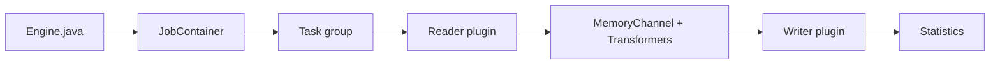

# alibaba/DataX

> Java tool for offline synchronization between heterogeneous data sources, via reader/writer plugins.

## The problem
Moving tables between databases, warehouses and files requires an ad hoc script for each source/target pair.

## What it actually does
An engine reads a JSON job and splits it into tasks; Reader plugins produce `Record`s that pass through a memory channel, then Writers write them. Optional transformers (filter, replace, Groovy). More than 40 connectors: MySQL, Oracle, PostgreSQL, HDFS/Hive, ClickHouse, Doris, MongoDB, HBase, Neo4j, MaxCompute. Launched via `datax.py`. Commercial version: Alibaba Cloud's DataWorks.

## How it is wired

## Trying it
The README contains no command: it points to the online "Quick Start" guide. Jobs are written in JSON, one template per plugin (`plugin_job_template.json`).

## Cost and gotchas
Free; license present but not identified by GitHub. README in Chinese; last push July 2026; 1,359 open issues. Support through issues only (limited DingTalk group). Maven build per plugin.

## What it is not
No real time in the open version: the README reserves real-time synchronization for the commercial product.

## Alternatives
DataWorks Data Integration (commercial version cited in the README).

## For you
Useful for bulk-copying data into a warehouse before modeling; worth watching, after checking the license.
