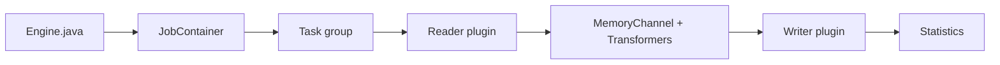

# alibaba/DataX

> Outil Java de synchronisation hors ligne entre sources de données hétérogènes, via plugins lecteur/écrivain.

## Le problème
Déplacer des tables entre bases, entrepôts et fichiers impose un script ad hoc par couple source/cible.

## Ce que ça fait vraiment
Un moteur lit un job JSON et le découpe en tâches ; des plugins Reader produisent des `Record` qui traversent un canal mémoire puis les Writer les écrivent. Transformateurs optionnels (filtre, remplacement, Groovy). Plus de 40 connecteurs : MySQL, Oracle, PostgreSQL, HDFS/Hive, ClickHouse, Doris, MongoDB, HBase, Neo4j, MaxCompute. Lancement via `datax.py`. Version commerciale : DataWorks d'Alibaba Cloud.

## Comment c'est branché

## Essayer
Le README ne contient aucune commande : il renvoie au guide « Quick Start » en ligne. Les jobs s'écrivent en JSON, un modèle par plugin (`plugin_job_template.json`).

## Coût et pièges
Gratuit ; licence présente mais non identifiée par GitHub. README en chinois ; dernier push juillet 2026 ; 1 359 issues ouvertes. Support via issues seulement (groupe DingTalk limité). Compilation Maven par plugin.

## Ce que ce n'est pas
Pas de temps réel dans la version ouverte : le README réserve la synchronisation temps réel au produit commercial.

## Alternatives
DataWorks Data Integration (version commerciale citée dans le README).

## Pour toi
Utile pour copier en lot des données vers un entrepôt avant modélisation ; à surveiller, après avoir vérifié la licence.

